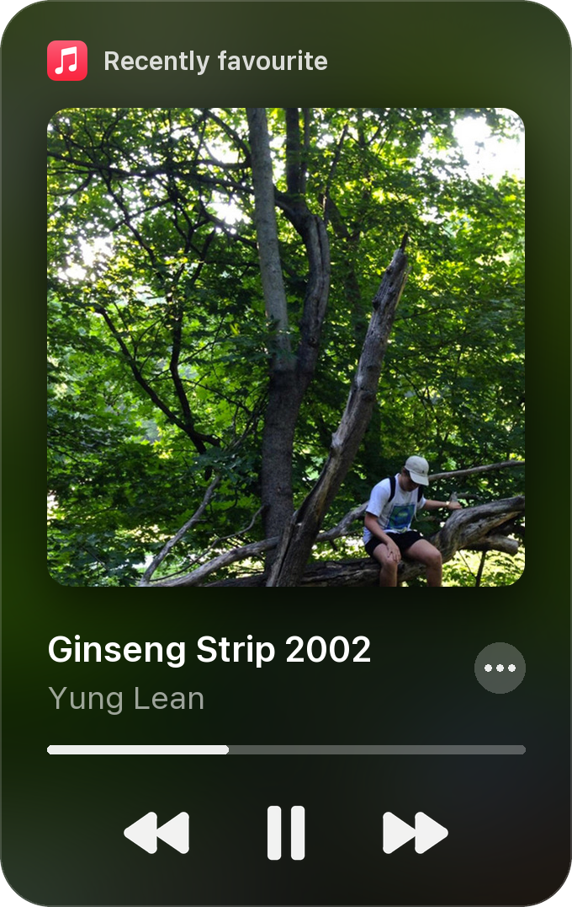

  
  
  
  

### &nbsp; about me

- computer science student at uit, vnuhcm
- i love digging into research, mostly ai and nlp
- i love turning ai into real products too
- on the side, i build hackintosh systems and tools, like [Mirra](https://github.com/eiyuumiru/Mirra)
- find me on discord: 

### &nbsp; if you like what i do

maybe consider buying me a coffee :)

### &nbsp; on repeat

